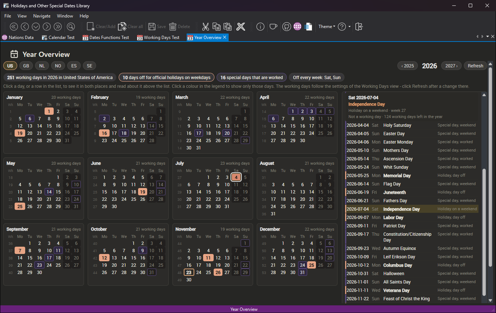

# Demo for 'Library-HolidaysFuncLib'

The `oCalendarHolidays.pkg` contains essential functions for managing holiday dates. For detailed information on how this function library operates, please refer to the documentation located at the top of `cCalendarHolidays.pkg`.

To see the 'Holiday Functions Library' in action, run the sample program `HolidaysFuncLibTest`. The 'Dates Functions Test' tab works in three steps. Pick one of the library's date functions from the list on the left - type in the search box above it to find one by name or description, and rest the mouse on a row to read what the function does. Then set the year and a two-letter ISO country code, and the answer shows at once: the date, the holiday's name in that country's language package, the week number, and the call to write in your own code. A strip below shows the same function for the two years before and after - click a year to go to it. At the bottom, 'Is this date a holiday?' asks the other way round: a date and a country give the holiday and the function that finds it. Only a limited number of national holiday packages are available; the country field says whether the country you chose has one.

If your country is not included in the grid, creating a new one is quite simple! Just refer to the examples in `CountryPackages.pkg` for guidance on how to do this.

In the 'Calendar Test' tab, you can see an example of how to create your own calendar that includes the names of holidays and special days. Additionally, there is a sample of a generalized lookup list for holidays. Click the 'Test Holiday Lookup List' button to see how this feature can be used to retrieve any selection of holidays.

The 'Working Days Test' tab (View > Working Days) shows the working-day functions of HolidaysFuncLib 1.0.4: `IsWorkingDay`, `AddWorkingDays` and `WorkingDaysBetween`. On the left are the library's settings - the country, the UK region (`piHolidayRegion`), the days off every week (`psWeekendMask`) and the company's closure days (`padClosedDays`). On the right, each function has a group of its own, and the answer says why a day is not a working day: a weekend day, an official holiday (named), or a closure day. The grid at the bottom lists every day between the two dates and how it was counted. It opens on Christmas 2026 in the UK, where the Boxing Day bank holiday moves to Monday 28 December.

The 'Year Overview' tab (View > Year Overview) shows a country's whole year, month by month: each day marked as a weekend day, a day off for an official holiday, a special day or a closure day, the working days of each month and of the year, and the list of the year's holidays and special days. Click a country or a year to change it. It is a FlexTron page, built with the [RDCFlexTron](https://github.com/NilsSve/Library-RDCFlexTron) library, and it follows the settings of the Working Days view. The About dialog (Help > About) is RDCFlexTron's too.

The demo needs DataFlex 26: open `HolidaysFuncLibDemo.sws`. The library itself works with DataFlex 24, 25 and 26.

In addition to the `oCalendarHolidays` package, there are specific 'National Holidays Date Functions' tailored to individual countries. Each country package will at least return holiday names as strings.

You can find a collection of country-specific libraries in `CountryPackages.pkg`. Use these files as templates to develop your own holiday packages for specific countries.

The workspace also includes a database and a view displaying facts about nations around the world, which is independent of the calendar holiday packages mentioned above. The 'Nations Data' tab shows each nation's flag - sharp SVG drawings from the [flag-icons](https://github.com/lipis/flag-icons) set (MIT), or the older PNG and GIF pictures - and converts an amount of its currency to another one, and back, at today's rates from [ExchangeRate-API](https://www.exchangerate-api.com)'s free open access (`cCurrencyRates.pkg`: no key needed, one call per run). In the lookup lists (the '...' buttons, or F4), a click on a column header sorts by that column, and typing opens a search on it - "SE" and Enter go to Sweden.

## Setup after cloning

The demo needs **DataFlex 26**. The libraries it uses - HolidaysFuncLib, RDCToolsLib, DFAbout, vWin32fh,
RDCFlexTron and Data Access's Web UI FlexTron - are **not** stored in this repository: `HolidaysFuncLibDemo.sws`
names them as dependencies, and DataFlex's package manager installs them into `DfPkg\` (and their web files into
`AppHtml\` and `Bitmaps\`). Run **`setup.bat`** once from the repository root: it runs `df-cli config` to install
them, and `skip-local-data.cmd`, so your local `Data\` database changes stay on your machine. Re-run it after a pull
that moves a library version.

Then open `HolidaysFuncLibDemo.sws` in DataFlex Studio 26, and compile and run `HolidaysFuncLibTest.src`.

